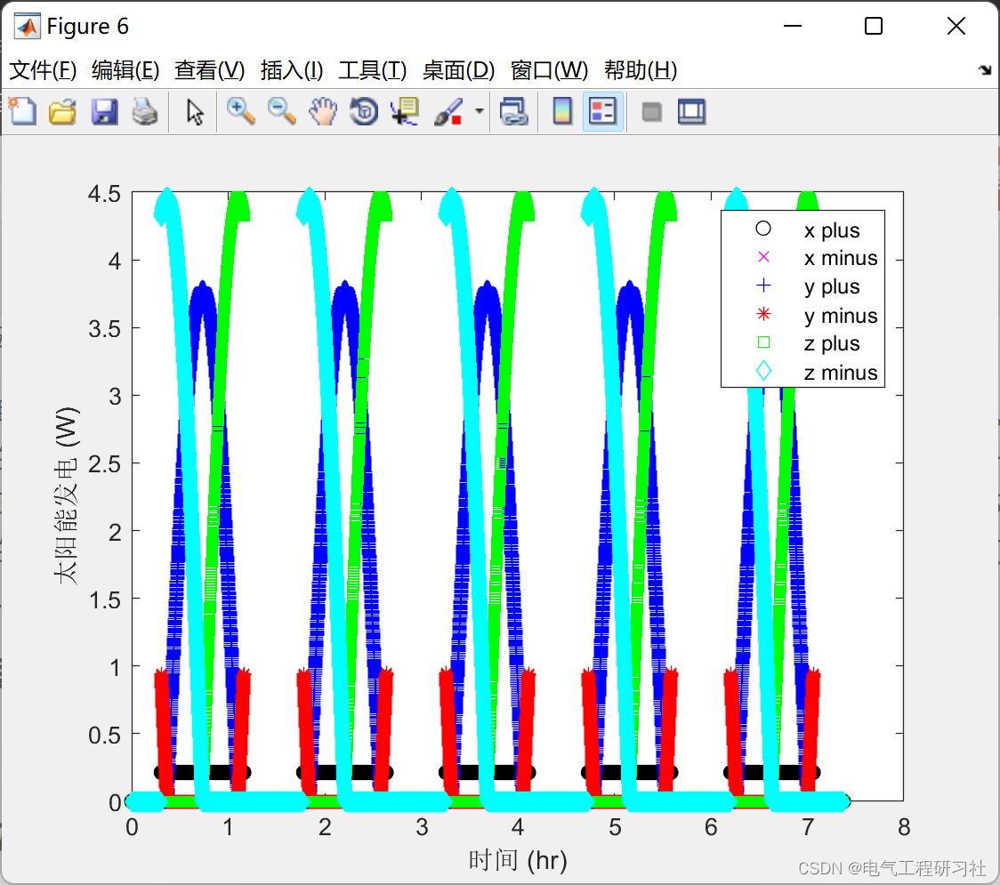
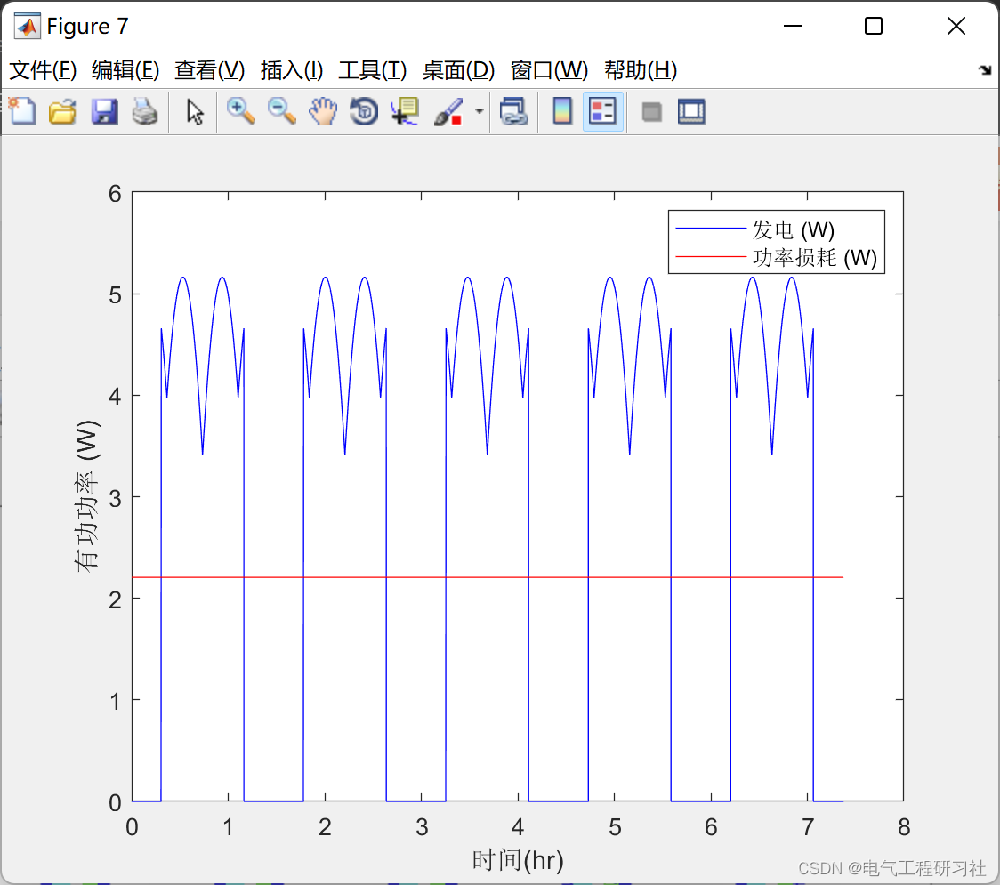
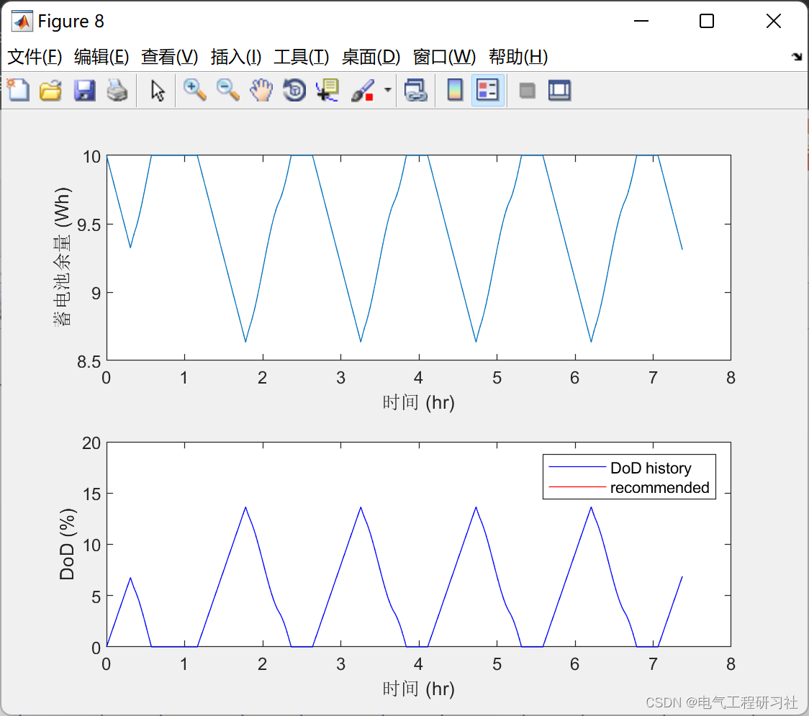
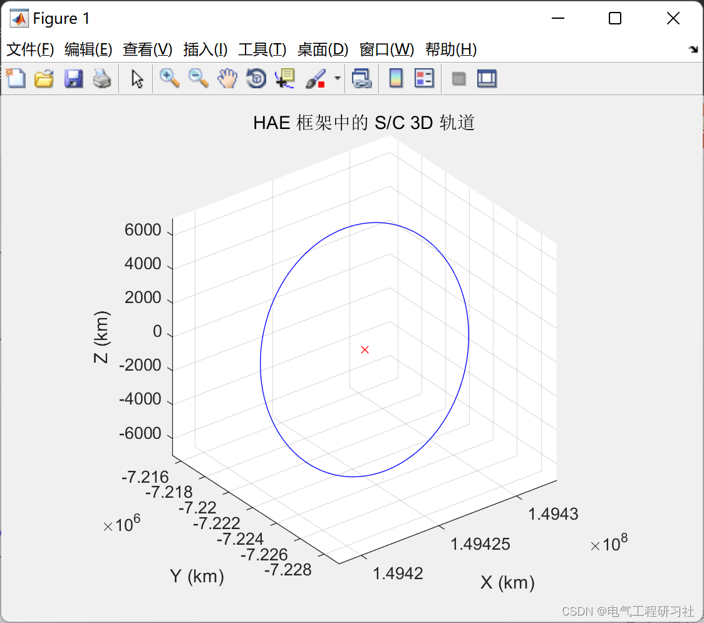
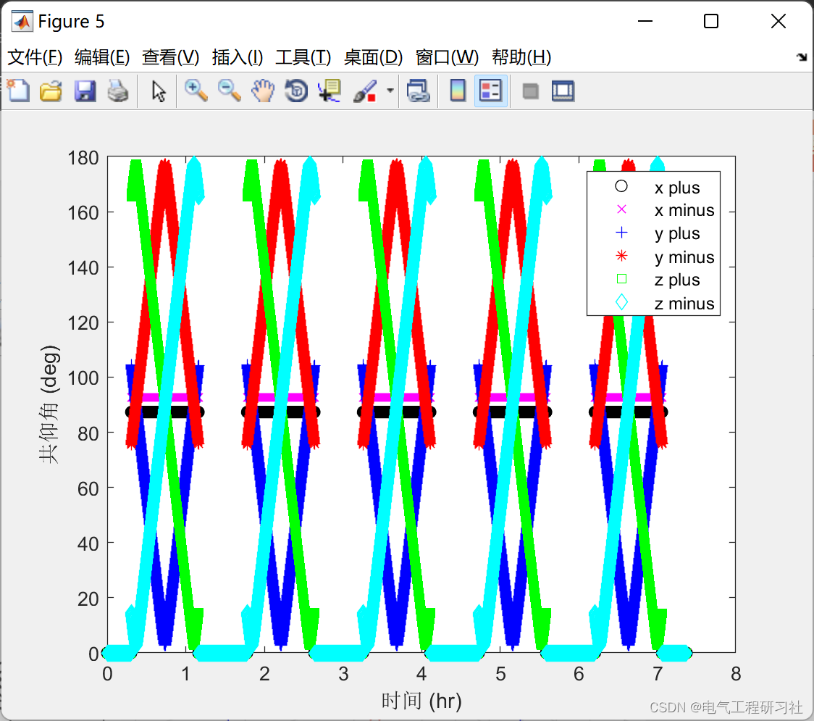
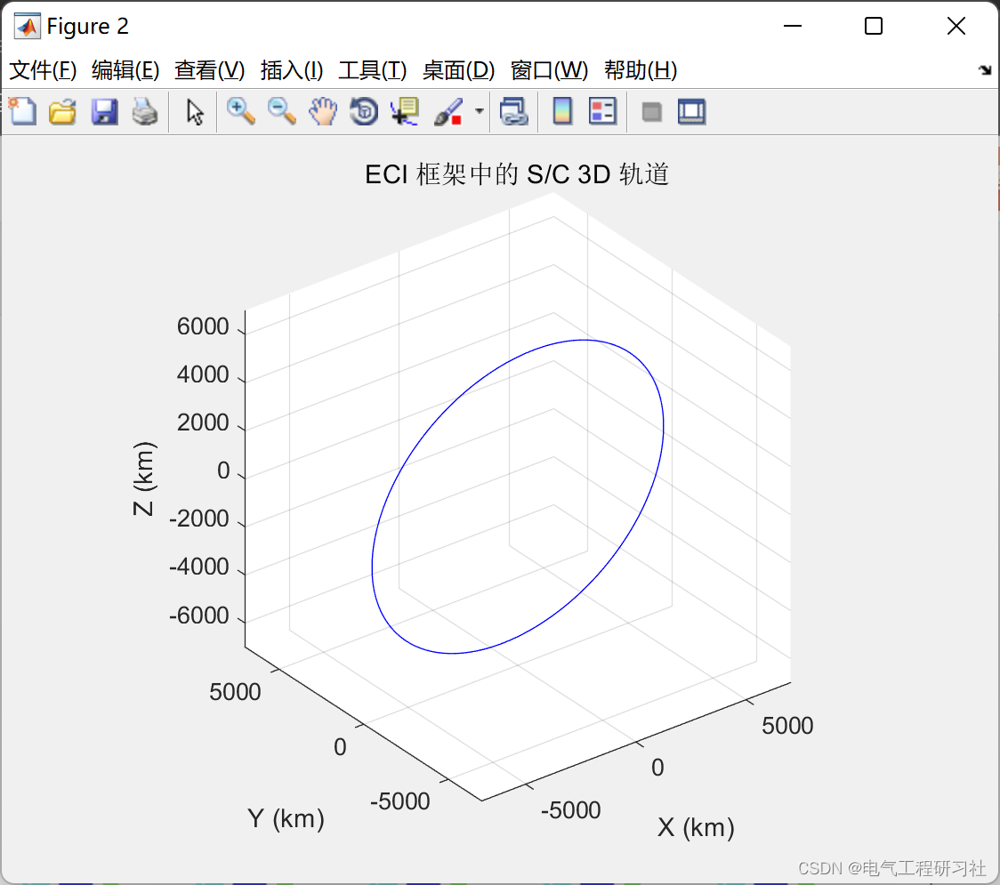
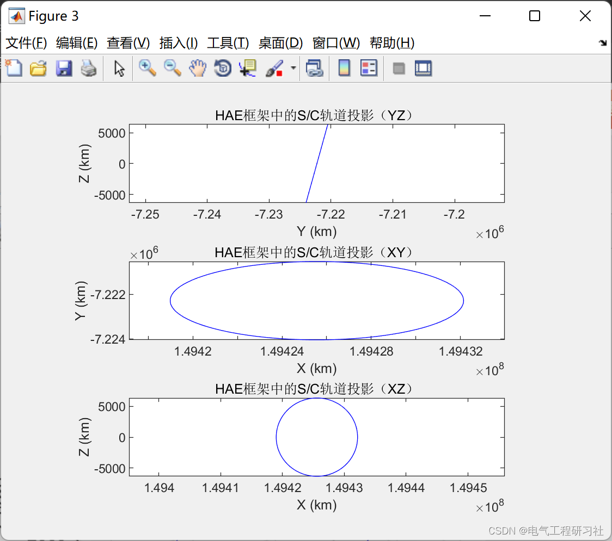
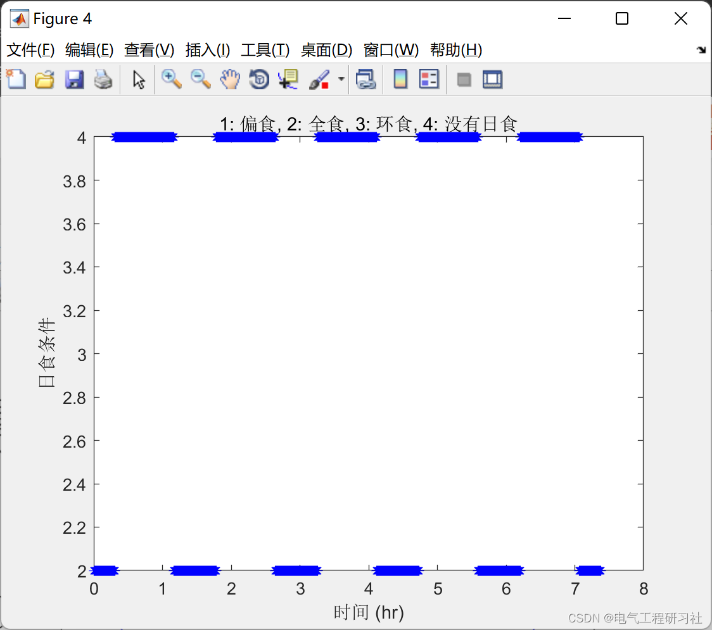
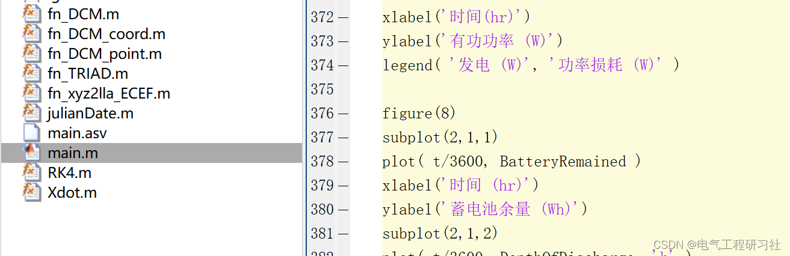

# Solar Power Generation and Battery Research (Matlab Code Implementation)

​  
1. Overview of the prediction of solar power system output power, especially short-term prediction, is affected by various external factors, and the prediction results are not ideal. Due to the dependency of existing prediction methods on external conditions such as solar radiation intensity and environmental temperature, there are multiple variables that affect the efficiency of predictions.
The reliability of key equipment is the foundation for the advanced, safe, and efficient implementation of solar power technology. The reliability of equipment needs to be comprehensively ensured from several aspects including hardware, operating conditions, dynamic equipment lubrication, and selection of heat transfer mediums.
Existing solar energy is inexhaustible and clean, making it the most known clean energy source. Photovoltaic power generation has received widespread attention from all sectors. However, the efficiency of solar cells is affected by light intensity and temperature, and only maintaining a certain working voltage can keep the solar cell at its maximum power state under specific conditions. The principle of photovoltaic power generation was first introduced, followed by an analysis of various factors affecting the efficiency of solar power generation. Subsequently, the method of tracking the maximum power point of solar cells using perturbation observation was implemented. Simulations verified the effectiveness of this method.
2. Running Results Editing
Editor
Editor
Editor
Editor
Editor
Editor
Editor
3. MATLAB Code
Editor
4. References [1] Hualong, Qichong, Liu Xuejiao. Solar Power Generation Forecast Based on RBF Neural Network [J]. Science and Industry, 2022, 22(07):375-380.
[2] Wang Qiaoli, Zhang Wenlang. MPPT Control Strategy for Solar Power Generation Systems [J]. Science and Innovation, 2022(09):70-72+77. DOI:10.15913/j.cnki.kjycx.2022.09.023.
5. Conclusion

## Images

<!-- PAYMENT_BLOCK -->

## Get this dataset

- Payment link (Stripe): [Buy now](https://buy.stripe.com/3cs8yP7sY87d0vu9AB)
- Payment QR code: 

<!-- /PAYMENT_BLOCK -->
